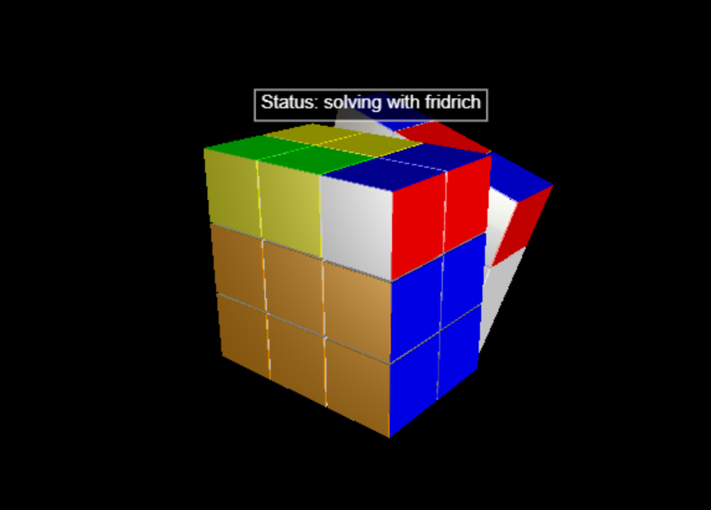

# 3D-Симулятор і збирач Кубика Рубіка
>Check out the [algorithm](/fridrich.py)! It was coded by hand

<p align="center">
  
</p>

> [!NOTE]
> Проблеми та парадигми цього проекту можуть доповнюватися з розвитком його концепції. Також радимо прочитати [Notes](/Notes.md)

> [!NOTE]
> Жодний штучний інтелект не застосовувався в жодній формі для жодного дотичного питання під час створення цього проекту, навіть для пошуку інформації

# Симулятор і збирач Кубика Рубіка
Це фінальний проект з курсу "Мови програмування" першого семестру першого року навчання в НаУКМА.<br>Його мета це продемонструвати володіння кількома парадигмами програмування, які розглядаються в цьому курсі шляхом проєктування та реалізації мультипарадигмального програмного рішення, поєднуючи об'єктно-орієнтоване, функціональне, скриптове та логічне/паралельне програмування.<br>Цим рішенням стало середовище для візуалізації автоматичної та ручної збірки Кубика Рубіка.
## Структура

```
final_project/
├── README.py                   # Essentials
|
├── archive_sraped_files/       # Outdated files
│   └── ...
|
├── kociemba/                   # Kociemba's close to "God's algorithm" method
│   └── ...
|
├── logs/                       # jsonl files
│   └── ...
|
├── videos/                     # Videos for each week
│   └── ...
|
├── Cube.py                     # OOP: base class for dimensions
├── Facelets.py                 # OOP and functional: subclass for creating a cube
├── fridrich.py                 # My own algorithm for human-like layer-by-layer solving (no AI, no references, just me)
├── gui.py                      # GUI and 3D model
├── kociemba_applied.py         # Implementation of Kociemba's algorithm
├── Notes.md                    # Thought process
├── Rubik.bat                   # Scripting: for launching project from desktop
├── save_scramble.sh            # Scripting: for creating JSONL files
├── main.py                     # Scripting-ish: gluing everything together
├── scramble.py                 # Scrambling using turns
├── turns.py                    # Functional: defining the permutations ("matrice" operations)
└── mypy.ini                    # Mypy configuration
```

## Проблеми
Проблеми, які лягли в основу концепції проекту та розв'язання яких стоїть на меті:
- **Філософський складник:**
    1. Занепад культури складання Кубика Рубіка.
    2. Створити середовище для навчання та практикування збирання Кубика Рубіка.

- **Практичний складник:**
    1. Складова середовища:
        1. Створити 3D візуалізацію Кубика Рубіка.
        2. Створити комфортний для візуального сприйняття та навчання UI/UX.
        3. Створити адаптацію алгоритмів та логіки для Кубиків Рубіка іншої розмірності.
    2. Складова автоматичної збірки:
        1. Створити алгоритм розбірки Кубика Рубіка.
        2. Створити алгоритм збірки Кубика Рубіка найшвидшою можливою комбінацією.
    3. Складова ручної збірки:
        1. Створити вивід алгоритму розбірки Кубика Рубіка згідно з правил спідкубінгу.
        2. Створити логіку таймеру для збірок Кубика Рубіка.
        3. Створити статистику збірок Кубика Рубіка з пам'яттю та leaderboard.

## Можливості
1. Генерація 3D Кубика Рубіка
2. Реалізація всіх поворотів граней в 3D і в структурі даних
3. Генерація алгоритму для розбірки Кубика
4. Генерація алгоритму для автоматичної збірки Кубика

## Парадигми
Парадигми, які розглядаються в курсі і за допомогою яких буде реалізовано проект:
1. **Об'єктно орієнтоване програмування** для представлення Кубика Рубіка та елементів.
2. **Функціональне програмування** для поворотів граней, генерації алгоритму розбірки, створення алгоритму "людської збірки", перевірки правильності стану Кубика Рубіка та оптимізації алгоритмів.
3. **Скриптове програмування** для ведення статистики.

## Встановлення
1. Клонуйте репозиторій
2. Встановість бібліотеку vpython `pip install vpython`
3. Запустіть `python main.py`

## Використання
1. Запустіть `python main.py`
2. Відкриється вікно з середовищем Кубика
3. Спостерігайте за надписом над Кубиком
4. Натисніть на екран, щоб продовжити

# :shipit: